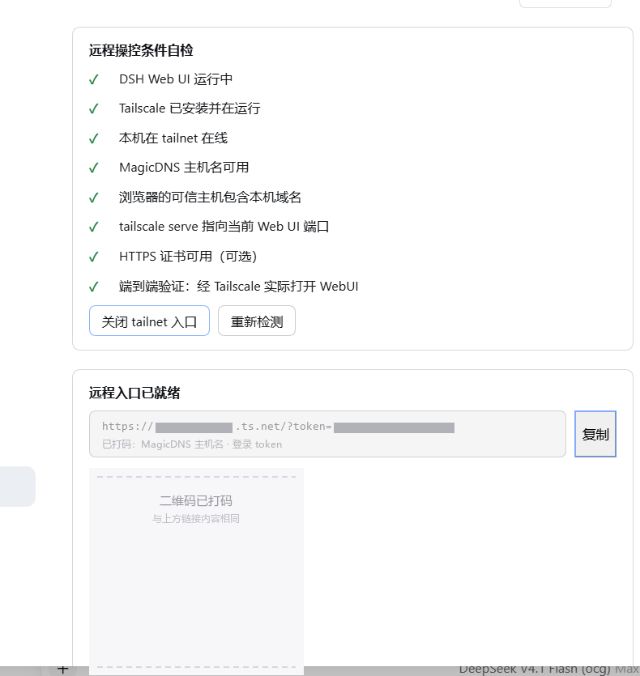
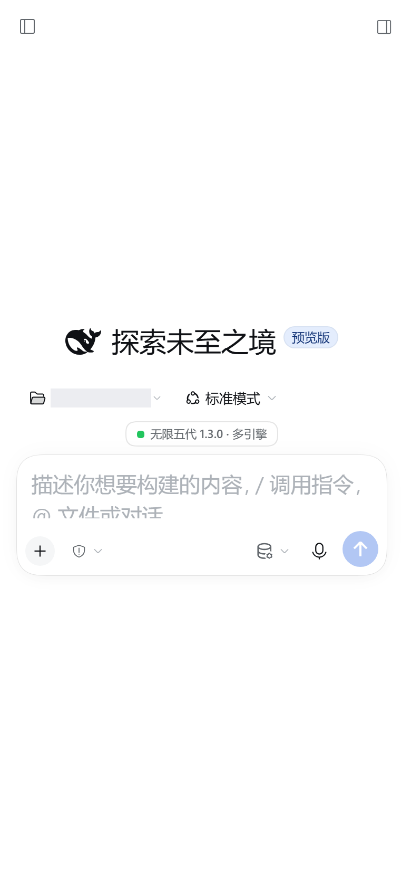

# dsh-remote-access


[](https://github.com/game25011/dsh-remote-access/actions/workflows/ci.yml)
[](https://www.npmjs.com/package/@game25011/dsh-remote-access)
[](LICENSE)

**Remote-control the local DSH through Tailscale.** The plugin exposes the running **DeepSeek Harness (DSH) Web UI** to your own [Tailscale](https://tailscale.com) tailnet, so a phone or tablet can drive the same sessions, models and permissions as the PC — with a settings page and `/remote` command for the authenticated login link.

## Screenshots

| Settings page (preflight checklist) | Opened from a phone viewport |
|---|---|
|  |  |
| Seven checks plus the end-to-end login must all pass before the link and QR appear. Host name and token are masked in this screenshot. | The same PC's DSH Web UI in a 390×844 mobile viewport, loaded over the tailnet. Workspace name is masked. |

Last verified end to end: **2026-11-21**, Windows 11 + Tailscale, every check green, end-to-end login passed.

## Why this one

Most remote plugins add a door of their own: an extra listening port, a relay, a tunnel client, a vendor account, or a companion app. This plugin adds none of that.

- **No new network surface.** The Web UI keeps binding `127.0.0.1`; the only external door is Tailscale Serve. Encryption and identity are WireGuard plus your tailnet ACL — no relay server, no vendor account, no Funnel.
- **DSH's own authentication, unchanged.** The link it hands you is DSH's normal token→cookie URL; the token is process-scoped and rotates on restart. Nothing to log in to twice, and no new credential store.
- **Verified before it offers a link.** The settings page runs seven preflight checks (Web UI running, Tailscale running, node online, MagicDNS name, trusted host, Serve mapping, HTTPS), then performs the real login through the tailnet — token exchange → cookie → WebUI index containing `__DSH_BOOT__`. The link and QR appear only when every check and that login pass; each failure names the check and the fix.
- **Nothing to install on the phone.** Any browser in the same tailnet works. The phone drives the same sessions, models and permission presets as the desktop.
- **Small and dependency-free.** No runtime dependencies (the QR encoder is vendored, MIT), ~36 KB tarball, 14 unit tests, runs inside the DSH process.

## What it does

- The Web UI keeps binding `127.0.0.1`; the only external door is Tailscale (WireGuard, tailnet-only).
- On activation the plugin reads the local Web UI port, builds the authenticated URL, writes it to `$DSH_HOME/remote-access/url.txt`, and runs `tailscale serve --bg --https=<port> http://127.0.0.1:<web port>`.
- `/remote` prints the login link (with the per-process token). `/remote on` / `/remote off` toggle the Serve mapping.
- A **Settings → 远程访问（Tailscale）** page shows the same link with a copy button, a QR code for the phone or tablet camera, the live Serve status/toggle and the full preflight checklist.
- Closing the app turns the Serve mapping off.
- No runtime dependencies, no telemetry; the QR encoder is vendored (MIT).

## Prerequisites (must all hold)

1. **The DSH Web UI is available and running** on the PC — the desktop app runs it, or a `dsh web` process does. The plugin attaches to that running Web UI; it does not start one.
2. **The Tailscale link is up on both ends** — Tailscale installed and logged in on the PC and on the phone/tablet, both nodes online in the same tailnet, and the tailnet hostname added to `connection.trustedHosts` (see below).
3. **The personal PC can stay powered on and awake** — the PC is the server: if it shuts down, sleeps, or the DSH app exits, the remote entry stops working.

Also required: DSH `>=0.2.2-rc.0 <0.3.0` (host services `webServer`, `connection`, `commands`), and **HTTPS Certificates enabled** for the tailnet (Tailscale admin → DNS → HTTPS Certificates) when using `--https=443`.

If any prerequisite is missing, `/remote` and the settings page show a readable error instead of failing silently.

## Install

From npm:

```sh
dsh plugin --profile <profile> add @game25011/dsh-remote-access
```

From a local checkout:

```sh
dsh plugin --profile <profile> add /path/to/dsh-remote-access
```

Then restart DSH; profile patches apply at startup.

## Trusted hosts (required)

DSH's browser trust fence only accepts loopback or authorities listed in `connection.trustedHosts`.
The bundle patch reads:

```
DSH_REMOTE_TRUSTED_HOSTS=host.tailnet.ts.net,100.x.y.z
```

or override the row in your own profile patch (applied after the bundle patch):

```yaml
- id: connection
  config:
    trustedHosts:
      - host.tailnet.ts.net
```

`/remote` prints a warning when the public host is missing from `trustedHosts`.

## Configuration

```yaml
- id: remote-access-link
  config:
    serve: true          # manage tailscale serve on/off
    servePort: 443       # https port served to the tailnet
    publicUrl: ''        # default: https://<MagicDNS name>/ from tailscale status --json
    tailscalePath: ''    # default: platform autodetect / PATH
    statusTimeoutMs: 5000
```

## Security

- The printed link contains a **process-scoped login token**; treat it like a password.
- Prefer a low default permission preset (e.g. `workspace-write` with approval) for remotely driven sessions.
- Tailscale Funnel is not used and not needed.
- The plugin does not change DSH authentication; the token/cookie flow stays the same.
- See [SECURITY.md](SECURITY.md) for the threat model and reporting.

## Maintenance

This plugin is maintained for the long run, with compatibility as the priority:

- **Compatibility first.** The plugin follows DSH releases. When a DSH change affects the plugin — host services, the client bundle contract, the settings slot, or config schema — a compatible release follows. Each release updates `engines.dsh` and is tested against the DSH version it claims to support.
- **Issues and pull requests are read and answered.** Bug reports about a prerequisite that does not check out, or a platform where detection is wrong, are the most useful kind.
- **Every release is reproducible.** A CHANGELOG entry per version, a git tag, a GitHub Release with the exact tarball, and the same artifact on npm.
- **MIT, permanently.** No license change, no paid tier, no telemetry.

## Docs

- [Interface contract](docs/INTERFACE.md)
- [Release guide](docs/RELEASING.md)
- [Test report](docs/TEST-REPORT.md)
- [Changelog](CHANGELOG.md)
- [AI disclosure](AI-DISCLOSURE.md)

## Roadmap

- Optional auto-revoke on idle.
- Non-Serve transports (explicit bind + own proxy).

## Development

```sh
node --check index.js
npm test
npm pack --dry-run
```

## Authorship and maintenance

Human-led, AI-assisted. The maintainer (**game25011**) sets the requirements, reviews every change,
performs the real-device testing (PC + Tailscale + phone/tablet) and publishes the releases. An
**AI coding agent (DeepSeek Harness)** writes the code, tests and documentation under that review.
See [AI-DISCLOSURE.md](AI-DISCLOSURE.md).

## License

MIT — see [LICENSE](LICENSE).

---

# 中文说明

**通过 Tailscale 远程操控本机 DSH**：把本机 **DSH Web UI** 通过 Tailscale Serve 暴露给 tailnet，手机/平板就能像在 PC 上一样使用同一批会话、模型和权限；插件提供设置页与 `/remote` 命令管理登录链接。

## 截图

| 设置页（条件自检） | 手机视口打开 |
|---|---|
|  |  |
| 七项自检与端到端登录全部通过才显示链接和二维码；图中主机名与 token 已打码。 | 同一台 PC 的 DSH Web UI 在 390×844 手机视口下的样子；图中工作区名已打码。 |

最近一次端到端实测：**2026-11-21**，Windows 11 + Tailscale，自检全绿，端到端登录通过。

## 为什么用它

多数远程插件会另开一道门：多监听一个端口、走中继、装隧道客户端、注册厂商账号，或者配一个手机 App。这个插件一样都不加。

- **不新增对外网络面**：网页服务仍只绑 `127.0.0.1`，唯一的对外入口是 Tailscale Serve；加密与身份由 WireGuard 和你的 tailnet ACL 承担，没有中继服务器、没有厂商账号、不启用 Funnel。
- **沿用 DSH 自己的认证**：给出的链接就是 DSH 原本的 token→cookie 登录地址，token 是进程级的、重启即换；不用二次登录，也不另建凭据存储。
- **先验过再给链接**：设置页先跑七项自检（Web UI 运行、Tailscale 运行、节点在线、MagicDNS、可信主机、Serve 映射、HTTPS），再真的走一遍登录——token 换 cookie、取回含 `__DSH_BOOT__` 的首页。全部通过才显示链接和二维码，任一项失败都指出是哪一项、该怎么修。
- **手机端什么都不用装**：同 tailnet 下任何浏览器都能开，手机上操作的就是桌面同一批会话、模型与权限档。
- **小且无依赖**：零运行时依赖（二维码编码器 vendored，MIT），tarball 约 36 KB，14 项单测，跑在 DSH 进程内。

## 行为

- 网页服务仍只绑 `127.0.0.1`，外部入口只有 Tailscale（WireGuard，仅 tailnet 可达）。
- 启动时自动读本机 web 端口，写登录链接到 `$DSH_HOME/remote-access/url.txt`，并执行 `tailscale serve --bg --https=<端口> http://127.0.0.1:<web端口>`。
- `/remote` 显示登录链接；`/remote on` / `/remote off` 开关 Serve 映射；应用退出时关闭映射。
- **设置 → 远程操控（Tailscale）** 页显示链接+复制、二维码、Serve 状态/开关与完整自检清单。
- 无运行时依赖、不联网、不调用模型；二维码编码器为 vendored（MIT）。

## 使用前提（三条必须同时满足）

1. **DSH Web UI 可用且在运行**（桌面应用自带，或 `dsh web` 进程）；插件依附它，不负责启动；
2. **Tailscale 链路打通**（PC 与手机/平板都安装并登录 Tailscale、同 tailnet 在线，且 tailnet 主机名已加入 `connection.trustedHosts`）；
3. **个人 PC 可保持开机与唤醒**（PC 是服务端，关机/睡眠/DSH 退出后远程入口即失效）。

安装：`dsh plugin --profile <profile> add @game25011/dsh-remote-access`，然后重启 DSH。

必需配置：把 tailnet 主机名加进信任栅栏——设 `DSH_REMOTE_TRUSTED_HOSTS=host.tailnet.ts.net`，或在 profile patch 里覆盖 `connection.config.trustedHosts`。

安全：链接含进程级登录 token，等同密码；远程会话建议用低权限档；不启用 Funnel；不改动 DSH 认证实现。详见 [SECURITY.md](SECURITY.md)。

## 维护承诺

长期维护，兼容性优先：

- **跟随 DSH 版本**：DSH 的宿主服务、客户端 bundle 契约、设置页插槽或配置结构变化导致插件失效时，跟进发兼容版本；每次发布都更新 `engines.dsh` 并在其声明支持的 DSH 版本上验证。
- **回应 issue 与 PR**：最有用的是「某项自检判断不对」或「某个平台探测走错了」这类反馈。
- **发布可追溯**：每个版本有 CHANGELOG 条目、git tag、附精确 tarball 的 GitHub Release，以及同款产物的 npm 包。
- **永久 MIT**：不改协议、不设付费档、不做遥测。

## 作者与维护

人主导、AI 辅助。维护者（**game25011**）定需求、逐项 review、在真实设备上测试（PC + Tailscale + 手机/平板）并负责发布；**AI 编码 agent（DeepSeek Harness）** 在上述 review 下编写代码、测试与文档。详见 [AI-DISCLOSURE.md](AI-DISCLOSURE.md)。
